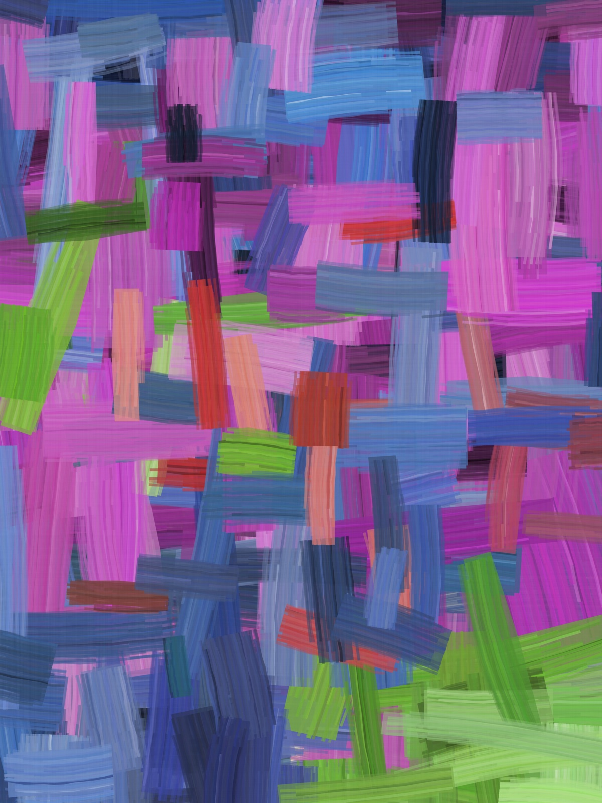

# art-attax

> **TL;DR: just paint!**
> Download [`app/art-attax.html`](app/art-attax.html).
> Double-click it, and drop in your **GTDB taxonomy** abundance file: see [Input format](#input-format) or press **Try an example**.
> No installation, works offline, and your data never leaves your computer.

**Abstract paintings generated from Bacterial microbial abundance data.**

art-attax turns a microbiome profile into a painting. Every bacterial taxon in the
[GTDB](https://gtdb.ecogenomic.org/) tree gets its own colour, chosen so that related
taxa get related colours, and the abundance of each taxon in your sample decides how
much of the canvas it claims.

<p align="center">
  
  <br>
  <em>A gut microbiome sample (<code>tests/fixtures/gut_microbiome_r232.tsv</code>), painted.</em>
</p>

---

## How it works

There are two steps. The first, making the palette, for version R232 it is already done and in the repo,
so you only need to paint. The app and the Python painter share the palette.

### 1. Make the palette (`palette/`)
`build.py` downloads the GTDB R232 bacterial taxonomy (one lineage per genome) and splits
it into one row per unique taxon, domain → species. Taxa are keyed on their full lineage,
because GTDB reuses names across different clades. `colours.py` then gives every taxon
a colour.

The colour wheel is shared out down the taxonomy like slices: each phylum gets a
slice of hues, each class gets part of its phylum's slice, and so on down to species, so
relatives always get similar hues. Bigger groups get wider slices.

Classes, orders and families also vary in lightness and saturation, so close relatives
don't all look identical. The result is the same every time it is run.

<p align="center">
  
  <br>
  <em>The colour key: phylum → class → order, wedges sized by the square root of species count.
  All 172 phyla are drawn; only the largest are labelled.</em>
</p>

### 2. Paint (`paint/`; the app's version is `app/template.html`)
- **`loader.py`** matches your abundance file to the palette.
- **`composer.py`** plans the strokes. A layer of big translucent blocks covers the
  canvas first. The stroke budget is then shared out by abundance, and abundant taxa
  also paint with a bigger brush. Strokes run mostly vertically or horizontally and
  gather into colour blocks, painted large to small.
- **`brushes.py`** renders each stroke with **py5** as a flat brush: a solid body of
  paint with streaky bristles, ragged ends and dry-brush gaps on top.

A taxon's hue never changes during painting (unless you use `--spread`). Only its tone varies, as mixed paint would.

---

## Getting started

There are two ways to use art-attax, as an app or as a Python script.

### Option 1: the app (no installation)

1. Download [`app/art-attax.html`](app/art-attax.html). On GitHub, open the file and press
   the download button (**Download raw file**) at the top right.
2. Double-click it. It opens in your web browser and works offline.
3. Drop in your abundance file (see [Input format](#input-format)), or press **Try an example**.

Nothing is uploaded: your data stays on your computer. In the app you can:

- **Regenerate** for a new painting. Each painting has a seed number, and the same number always
  gives the same painting
- Pick a **style**: brush strokes, ink brush, watercolour, pointillism, splatter, stained
  glass, or a petri dish, where your sample is streaked across an agar plate and every
  colony is one taxon
- Set the **coverage**: how much of the canvas is painted
- Pick the **colours**: the GTDB colour wheel (default; matches the colour key, so colours
  mean the same in every sample), or pick a preferred palette such as Viridis, Magma or Spectral,
  stretched across your sample with relatives kept side by side
- **Spread** the colour hue spread (GTDB colour wheel only), this ensures a sample that is mostly one group
  isn't all one similar colour
- Choose a portrait, landscape or square canvas, and **Download PNG** to keep a painting
- See which names aren't exact GTDB names, with a suggestion for each that you can choose to use

### Option 2: Python (command line)

For painting many files, or scripting. Only brush strokes and the GTDB colour wheel are
available here; the other styles and colour schemes are in the app.

Everything runs in Docker:

```bash
git clone <this repository> && cd art-attax
docker-compose build
```

Then paint. There is no GTDB download: the colours for every R232 taxon ship with the
repo in [`palette/`](palette/). To build a palette for a new release, see
[Rebuilding the palette](#rebuilding-the-palette).

```bash
docker-compose run --rm art-attax python main.py paint tests/fixtures/gut_microbiome_r232.tsv
```

The painting is saved to `outputs/gut_microbiome_r232.png`.

#### Commands

| Command | What it does |
|---|---|
| `python main.py paint <file>` | Paint an abundance file |
| `python -m paint.key` | Draw the colour key (phylum → class → order) to `outputs/colour_key.png` |
| `python main.py build-palette` | Maintainers: make the palette for a new GTDB release ([below](#rebuilding-the-palette)) |
| `python main.py build-app` | Maintainers: rebuild `app/art-attax.html` after editing `app/template.html` |

Run each inside the container, e.g. `docker-compose run --rm art-attax python main.py paint ...`.
Add `--help` to any command to see its options.

#### `paint` options

| Option | Default | |
|---|---|---|
| `<file>` | required | Abundance file (see [Input format](#input-format)) |
| `--output <path>` | `outputs/<file name>.png` | Where to save the PNG |
| `--width <pixels>` | 2400 | Canvas width |
| `--height <pixels>` | 3200 | Canvas height. Try `--width 3200 --height 1800` for landscape |
| `--strokes <number>` | 400 | Number of main brushstrokes (plus a fixed underpainting layer) |
| `--spread <0–1>` | 0 | Move the sample's colours apart: 0 = off, 1 = most. Colours then no longer match the colour key or other paintings |
| `--fuzzy` | off | Also paint names that aren't exact GTDB names, using the closest match |

To paint with a different palette file, set `GTDB_PALETTE_PATH`, e.g.
`docker-compose run --rm -e GTDB_PALETTE_PATH=/app/my_palette.parquet art-attax python main.py paint ...`

---

## Input format

A tab-separated file (the app also takes comma-separated), with one taxon per line followed
by its abundance. A header row is skipped if present. Use the full GTDB lineage, or a species
name. Abundance can be read counts, fractions (`0.42`) or percentages (`42.0`): only
proportions matter, so use one unit throughout a file. Zeros are left out.

```
d__Bacteria;p__Bacteroidota;c__Bacteroidia;o__Bacteroidales;f__Bacteroidaceae;g__Bacteroides;s__Bacteroides fragilis	42180
d__Bacteria;p__Bacteroidota;c__Bacteroidia;o__Bacteroidales;f__Bacteroidaceae;g__Prevotella;s__Prevotella copri	31200
```

Names must match GTDB exactly. Anything else is listed with the closest GTDB lineage,
if there is one, and left out of the painting. To paint those suggestions instead, tick the
box in the app or use `--fuzzy`. It is the same name under different higher ranks,
the same species under a GTDB letter suffix, or the closest known relative. Suggestions are risky
guesses, so check them!

---

## Rebuilding the palette

Only needed for a new GTDB release or different colours. One command downloads the
[GTDB taxonomy](https://gtdb.ecogenomic.org/downloads) for that release, colours it, writes
`palette/gtdb_r<release>_colours.parquet`, rebuilds the app and deletes the download:

```bash
docker-compose run --rm art-attax python main.py build-palette --release 232
```

| Option | Default | |
|---|---|---|
| `--release <number>` | required | GTDB release, e.g. `232` |
| `--taxonomy <path>` | download it | Use a `bac120_taxonomy_r<release>.tsv.gz` you've already downloaded, saved inside the repo folder (it is kept) |

The painter and the app use the newest release in `palette/`. After editing the app
(`app/template.html`), rebuild it with `python main.py build-app`.

---

## Stack

Parquet · polars · py5 · matplotlib · Typer · plain JavaScript (app)

## License

[MIT](LICENSE) © 2026 Varsha Kale (code)

### Palette licence

`palette/gtdb_r232_colours.parquet` holds every GTDB R232 bacterial taxon (domain → species)
with its assigned colour. The taxonomy is adapted from the
[Genome Taxonomy Database](https://gtdb.ecogenomic.org/) (release R232), licensed under
[CC BY-SA 4.0](https://creativecommons.org/licenses/by-sa/4.0/). Changes: genome
accessions removed, taxa deduplicated by rank, colours added. The palette file and the
colour key image are shared under CC BY-SA 4.0 too; the MIT licence covers the code only.
