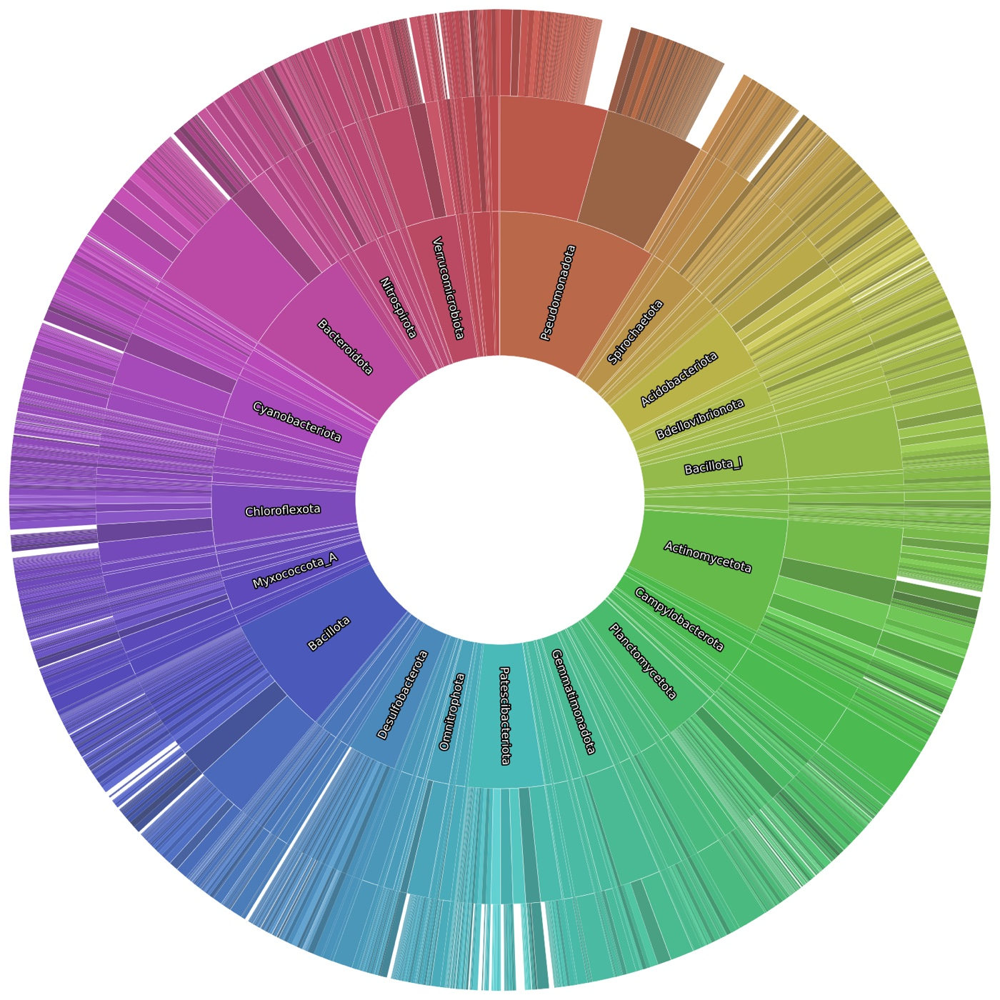

# art-attax

**Abstract paintings generated from microbial abundance data.**

art-attax turns a microbiome profile into a painting. Every bacterial taxon in the
[GTDB](https://gtdb.ecogenomic.org/) tree gets its own colour, chosen so that related
taxa get related colours, and the abundance of each taxon in your sample decides how
much of the canvas it claims.

<p align="center">
  
  <br>
  <em>A gut microbiome sample (<code>tests/fixtures/gut_microbiome_r232.tsv</code>), painted.</em>
</p>

---

## How it works

The pipeline has three phases. The results of the first two are already in the repo, so
you only need to run the third.

### 1. Build the taxonomy database (`db/build_db.py`)
The GTDB R232 bacterial taxonomy (~one lineage per genome) is split into its seven
ranks (domain → species) and loaded into **DuckDB**, with one row per unique taxon.
Taxa are keyed on their full lineage string, because GTDB reuses names across
different clades. A Parquet copy is written for fast reads.

### 2. Give every taxon a colour (`db/assign_colours.py`)
The colour wheel is shared out down the taxonomy like slices of cake: each phylum gets a
slice of hues, each class gets part of its phylum's slice, and so on down to species, so
relatives always get similar hues. Bigger groups get wider slices.

Classes, orders and families also vary in lightness and saturation, so close relatives
don't all look identical. The result is the same every time it is run.

<p align="center">
  
  <br>
  <em>The colour key: phylum → class → order, wedges sized by the square root of species count.
  All 172 phyla are drawn; only the largest are labelled.</em>
</p>

### 3. Paint (`paint/`)
- **`loader.py`** matches your abundance file to the palette.
- **`composer.py`** plans the strokes. A layer of big translucent blocks covers the
  canvas first. The stroke budget is then shared out by abundance, and abundant taxa
  also paint with a bigger brush. Strokes run mostly vertically or horizontally and
  gather into colour blocks, painted large to small.
- **`brushes.py`** renders each stroke with **py5** as a flat brush: a solid body of
  paint with streaky bristles, ragged ends and dry-brush gaps on top.

A taxon's hue never changes during painting (unless you use `--spread`). Only its tone varies, as mixed paint would.

---

## Quick start

Everything runs in Docker. On macOS this repo uses [Colima](https://github.com/abiosoft/colima).

```bash
colima start
docker-compose build
```

Then paint. There is no GTDB download: the colours for every R232 taxon ship with the
repo in [`palette/`](palette/).

```bash
docker-compose run --rm art-attax python main.py paint tests/fixtures/gut_microbiome_r232.tsv
```

The painting is saved to `outputs/gut_microbiome_r232.png`. To draw the colour key:

```bash
docker-compose run --rm art-attax python -m paint.key
```

### Painting options

| Option | Default | |
|---|---|---|
| `--output` | `outputs/<input name>.png` | output path |
| `--width` / `--height` | 2400 × 3200 | canvas size in pixels |
| `--strokes` | 400 | number of main brushstrokes |
| `--fuzzy` | off | also paint names that aren't exact GTDB names, using the closest match |
| `--spread` | 0 | from 0 (off) to 1: move the sample's hues apart, for more contrast between close relatives. Colours then no longer match the colour key or other paintings |

---

## Input format

A tab-separated file with no header (a header row is skipped if present): one taxon
per line, then its abundance. Use the full GTDB lineage, or a species name. Abundance can be
read counts, fractions (`0.42`) or percentages (`42.0`): only proportions matter, so use one
unit throughout a file.

```
d__Bacteria;p__Bacteroidota;c__Bacteroidia;o__Bacteroidales;f__Bacteroidaceae;g__Bacteroides;s__Bacteroides fragilis	42180
d__Bacteria;p__Bacteroidota;c__Bacteroidia;o__Bacteroidales;f__Bacteroidaceae;g__Prevotella;s__Prevotella copri	31200
```

Names must match GTDB R232 exactly. Anything else is listed with the closest GTDB lineage,
if there is one, and left out of the painting. With `--fuzzy`, those suggestions are painted
instead: the same name under different higher ranks, the same species under a GTDB letter
suffix, or the closest known relative. Suggestions are a guess, so check them.

---

## Rebuilding the palette

Only needed for a new GTDB release or different colours. Download the
[GTDB taxonomy](https://data.gtdb.aau.ecogenomic.org/releases/release232/232.0/bac120_taxonomy_r232.tsv.gz),
save it as `data/bac120_taxonomy.tsv.gz`, then:

```bash
docker-compose run --rm art-attax python main.py build-db
docker-compose run --rm art-attax python main.py assign-colours
docker-compose run --rm art-attax python main.py export-palette
```

---

## Stack

DuckDB · Parquet · polars · py5 · matplotlib · Typer

## License

[MIT](LICENSE) © 2026 Varsha Kale (code)

### Palette licence

`palette/gtdb_r232_colours.parquet` holds every GTDB R232 bacterial taxon (domain → species)
with its assigned colour. The taxonomy is adapted from the
[Genome Taxonomy Database](https://gtdb.ecogenomic.org/) (release R232), licensed under
[CC BY-SA 4.0](https://creativecommons.org/licenses/by-sa/4.0/). Changes: genome
accessions removed, taxa deduplicated by rank, colours added. The palette file and the
colour key image are shared under CC BY-SA 4.0 too; the MIT licence covers the code only.
