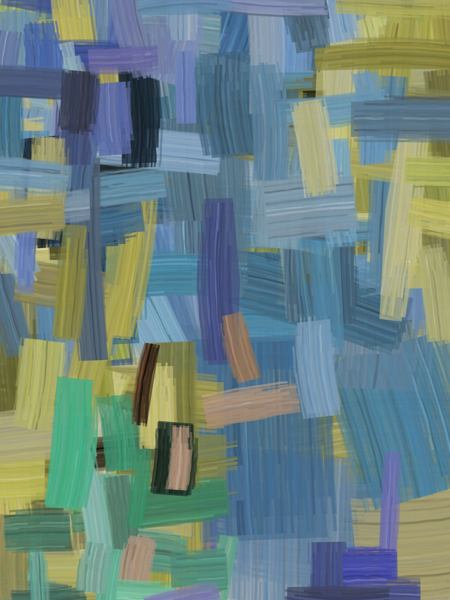
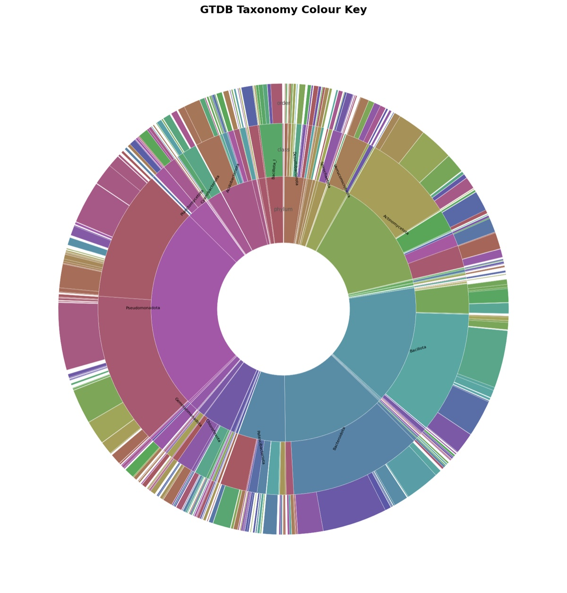

# art-attax

**Abstract paintings generated from microbial abundance data.**

art-attax turns a microbiome profile into a painting. Every bacterial taxon in the
[GTDB](https://gtdb.ecogenomic.org/) tree gets its own colour, chosen so that related
taxa get related colours, and the abundance of each taxon in your sample decides how
much of the canvas it claims.

<p align="center">
  
  <br>
  <em>A gut microbiome sample (<code>tests/fixtures/gut_microbiome.tsv</code>), painted.</em>
</p>

---

## How it works

The pipeline has three phases.

### 1. Build the taxonomy database (`db/build_db.py`)
The GTDB R232 bacterial taxonomy (~one lineage per genome) is split into its seven
ranks (domain → species) and loaded into **DuckDB**, with one row per unique taxon.
Taxa are keyed on their full lineage string, because GTDB reuses names across
different clades. A Parquet copy is written for fast reads.

### 2. Give every taxon a colour (`db/assign_colours.py`)
The tree is embedded in a 2D **Poincaré disk** (hyperbolic space, via `geoopt`).
Hyperbolic geometry suits hierarchies: related taxa land near each other, the root
sits near the centre and species spread out towards the edge. Each position is then
read as a colour:

| Disk position | Colour |
|---|---|
| angle | hue (each clade owns a region of the colour wheel) |
| distance from centre | saturation (deeper ranks are more vivid) |

<p align="center">
  
  <br>
  <em>The colour key: phylum → class → order, wedges sized by species count.</em>
</p>

### 3. Paint (`paint/`)
- **`loader.py`** matches your abundance file to the database.
- **`composer.py`** plans the strokes. A layer of big translucent blocks covers the
  canvas first. The stroke budget is then shared out by abundance, and abundant taxa
  also paint with a bigger brush. Strokes run mostly vertically or horizontally and
  gather into colour blocks, painted large to small.
- **`brushes.py`** renders each stroke with **py5** as a flat brush: a solid body of
  paint with streaky bristles, ragged ends and dry-brush gaps on top.

A taxon's hue never changes during painting. Only its tone varies, as mixed paint would.

---

## Quick start

Everything runs in Docker. On macOS this repo uses [Colima](https://github.com/abiosoft/colima).

```bash
colima start
cp env.example ../.env          # compose reads .env from one level ABOVE the repo
docker-compose build
```

Download the GTDB taxonomy and save it as `data/bac120_taxonomy.tsv.gz`:
<https://data.gtdb.aau.ecogenomic.org/releases/release232/232.0/bac120_taxonomy_r232.tsv.gz>

Then run the three phases:

```bash
docker-compose run --rm art-attax python main.py build-db
docker-compose run --rm art-attax python main.py assign-colours
docker-compose run --rm art-attax python main.py paint tests/fixtures/gut_microbiome.tsv
```

The painting is saved to `outputs/gut_microbiome.png`. To draw the colour key:

```bash
docker-compose run --rm art-attax python -m paint.key
```

### Painting options

| Option | Default | |
|---|---|---|
| `--output` | `outputs/<input name>.png` | output path |
| `--width` / `--height` | 2400 × 3200 | canvas size in pixels |
| `--strokes` | 400 | number of main brushstrokes |

---

## Input format

A tab-separated file with no header (a header row is skipped if present): one taxon
per line, then a count. Use the full GTDB lineage, or a species name.

```
d__Bacteria;p__Bacteroidota;c__Bacteroidia;o__Bacteroidales;f__Bacteroidaceae;g__Bacteroides;s__Bacteroides fragilis	42180
d__Bacteria;p__Bacteroidota;c__Bacteroidia;o__Bacteroidales;f__Prevotellaceae;g__Prevotella;s__Prevotella copri	31200
```

Taxa that can't be matched to GTDB R232 are skipped with a warning. Use current GTDB
names: older names such as `Firmicutes_A` won't match.

---

## Stack

DuckDB · Parquet · polars · geoopt / PyTorch · py5 · matplotlib · Typer

## License

[MIT](LICENSE) © 2026 Varsha Kale
